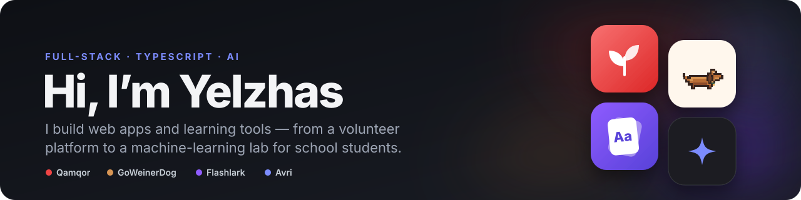
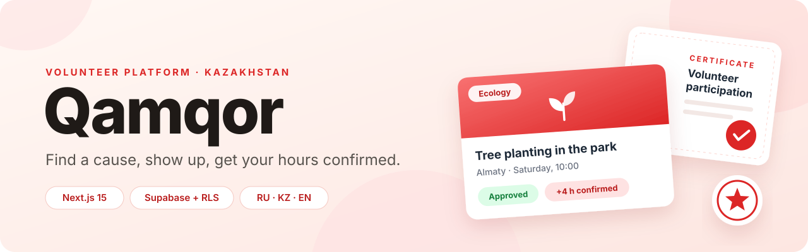
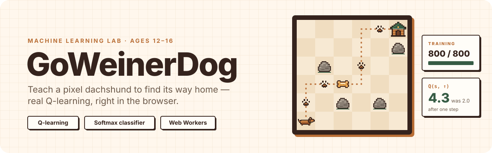
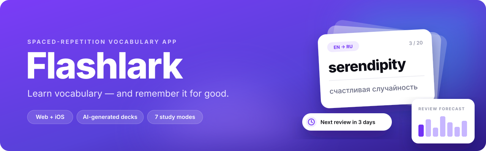
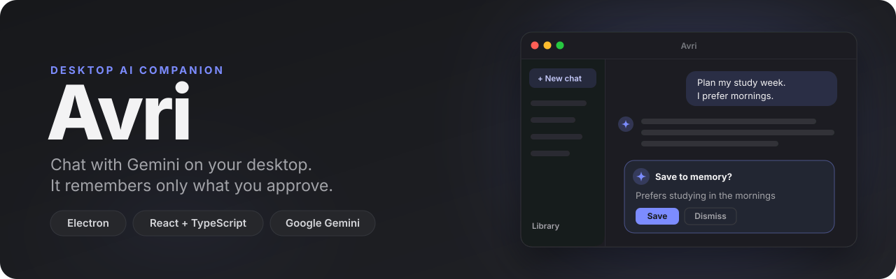

 

I build web apps end to end: database schema and security policies, server logic, interface and deployment. Most of my projects sit where **education meets AI**: a lab where school students train a model themselves, a vocabulary app built on spaced repetition, and a desktop assistant whose memory you control.

## Featured projects

<table>
<tbody>
<tr>
<td width="50%" valign="top">

### [Qamqor](https://github.com/YelzhasTem/Qamqor)

Volunteer platform for Kazakhstan: projects, applications, confirmed hours, achievements and PDF certificates. Roles and ownership are enforced in PostgreSQL with Row Level Security.

**[Live demo](https://qamqor-drab.vercel.app)** · `Next.js 15` `Supabase` `PostgreSQL`

</td>
<td width="50%" valign="top">

### [GoWeinerDog](https://github.com/YelzhasTem/GoWeinerDog)

Machine learning lab for students aged 12–16. A pixel dachshund learns from the student's examples and from rewards, with real Q-learning and a softmax classifier running in a Web Worker.

**[Try it](https://goweinerdog.vercel.app)** · `React` `TypeScript` `Playwright`

</td>
</tr>
</tbody>
<tbody>
<tr>
<td width="50%" valign="top">

### [Flashlark](https://github.com/YelzhasTem/flashlark)

Vocabulary app with spaced repetition, AI-generated decks, seven study modes and a community deck library. Runs on the web and on iOS.

**[Open the app](https://word-ace-deck.vercel.app)** · `TanStack Start` `Supabase` `Gemini` `Capacitor`

</td>
<td width="50%" valign="top">

### [Avri](https://github.com/YelzhasTem/Avri)

Desktop AI companion that streams answers from Gemini, keeps chats on your machine and remembers only the facts you approve.

`Electron` `React` `TypeScript` `Gemini`

</td>
</tr>
</tbody>
</table>

## Tech I work with

  
  
  
  
  
  

  
  
  
  

  
  
  
  

